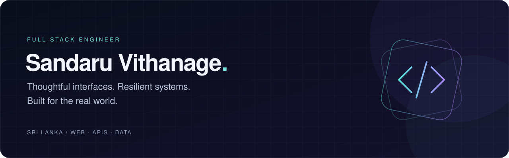

  

  
  
  

  I connect the details that make a product work: 
  <strong>clear interfaces, reliable APIs, and data boundaries you can trust.</strong>

 

## 01 / Featured build

### EduVerse · A connected school, by design
**Multi-tenant school management SaaS · Phase 1 in production**

**My role:** Lead developer, architect, and project owner · Team project

A platform for Sri Lankan schools that brings school operations and public websites together, with tenant isolation built into the database.

- **Data isolation:** PostgreSQL Row-Level Security separates each school's data.
- **Offline workflows:** IndexedDB and background jobs support data capture in low-connectivity environments.
- **Access control:** Permission-driven roles, OAuth2/JWT authentication, and MFA.
- **School websites:** A bilingual CMS with per-school subdomains and a draft-to-publish workflow.

`NestJS` `Next.js` `PostgreSQL` `Prisma` `Redis` `BullMQ` `Docker`

[Visit EduVerse →](https://eduverse.site)

## 02 / More from the workbench

| Project | What I'm building | Stack |
| :--- | :--- | :--- |
| [Agricultural Operations Platform](https://github.com/SandaruWithanage/agri-operations-platform) | A foundation for agricultural field operations, with hybrid authentication, database access policies, and English/Sinhala registration. **In development.** | NestJS · Next.js · PostgreSQL · Prisma |
| [OEMS](https://github.com/SandaruWithanage/oems) | An office equipment management system with authentication, permission controls, audit logging, and an initial assets workflow. **In development.** | Next.js · NestJS · Prisma · PostgreSQL |
| [StarEvents](https://github.com/SandaruWithanage/EventTicketingSystem) | Event management and booking, with role-based access, QR-code tickets, and sales dashboards. | React · Express · SQLite |

[Browse all repositories →](https://github.com/SandaruWithanage?tab=repositories)

## 03 / Engineering toolkit

| Area | Technologies |
| :--- | :--- |
| **Languages** | TypeScript · JavaScript · SQL · Java · C# · PHP · Python |
| **Frontend** | React · Next.js · Angular · Tailwind CSS |
| **Backend** | NestJS · Node.js · Spring Boot · .NET · Laravel · Prisma |
| **Data & background work** | PostgreSQL · MySQL · Redis · BullMQ · IndexedDB |
| **Delivery & testing** | Docker · Linux · Nginx · GitHub Actions · Jest · Playwright |

## 04 / Foundations & curiosity

- **Pearson HND in Computing** — ESOFT, Colombo
- **ICET Certified Master programme** — ICET, Panadura
- **Diploma in Software Engineering** — NIBM, 2023–2024
- Exploring AI alongside full-stack engineering.

## 05 / Code in motion

  

A year of contributions, in motion · Refreshed daily

---

**Have a project or engineering opportunity in mind?**  
[Let's connect on LinkedIn](https://www.linkedin.com/in/sandarux) · [Send me an email](mailto:sandaruvithanage.dev@gmail.com)

